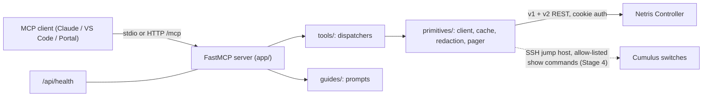

# Netris MCP — Staged Delivery Plan

> Repository: `iamjarvs/netris-mcp` (branch `rebuild/staged`). Structure follows the
> `netris-demo-tool-template`; tool surface and QA discipline are inspired by `mcp-apstra`.
> Lab target: `https://adam-ctl.netris.io` (note the hyphen; credentials live only in the gitignored `.env`).

## 1. Why this exists

| Pain point | Business value |
|---|---|
| Netris state is spread over v1 and v2 REST APIs, the UI and switch CLIs | One conversational interface: "why is this V-Net down?" answered in seconds |
| Engineers copy and paste between UI, API docs and switch shells | A read-only first, audited path to live fabric facts, with write operations gated behind explicit opt-in |
| Pre-sales demos need a live, credible AI-ops story | Plug-and-play tool for the Demo Portal (`start.sh`, `stop.sh`, `/api/health`) |

## 2. Baseline findings (Stage 0 audit)

- The existing repo has about 12 tool modules and 11 guides, built on the official `mcp` SDK, stdio only, with 5 test files and no CI.
- **Path bugs against the live controller:** `/api/v2/v-net/`, `/api/v2/acl`, `/api/v2/tenant`, `/api/v2/ipam/subnet` and `/api/v2/hw/switch` (GET) all return 404 or empty. ACL, tenants and static routes are v1-only (`/api/acl`, `/api/tenants`, `/api/routes`). Every tool must be re-verified live.
- Live API facts: auth is `POST /api/auth` with `{user, password}`, which sets the `connect.sid` cookie. Responses use the `{data, isSuccess, errors, meta}` envelope. The lab has 1 site (Datacenter-A), a Default VPC, 4 tenants, an eBGP session and links. Switch inventory under `/hw/switch` returns an empty map, so `GET /api/v2/hw` is likely the correct listing.
- Template contract to adopt: `start.sh`, `stop.sh`, `.env.example`, `config.example.json`, `requirements.txt`, `app/{config,netris_client,webserver}.py`, `/api/health`, and a CI workflow.

## 3. Architecture decisions

| Decision | Choice | Rationale |
|---|---|---|
| MCP framework | FastMCP 3.x | Same as the Apstra server: middleware, Context, structured output |
| Transports | stdio (default) and streamable HTTP at `/mcp` | Claude Desktop and VS Code use stdio; the Demo Portal needs HTTP and `/api/health` |
| Layout | Template layout: `app/` package with `tools/`, `guides/`, `primitives/` | Matches the demo template; `pyproject.toml` is kept for `pip install` and the console entrypoint |
| Safety | **Read-only by default**; `NETRIS_MCP_MODE=read-write` is needed for mutations, and each mutation has a `dry_run=True` default | Pre-sales and customer-safe |
| Tool surface | Compact umbrella dispatchers by default; `NETRIS_MCP_TOOL_SURFACE=full` exposes granular tools | Keeps the LLM context small (Apstra lesson) |
| Output | Token-aware: digest first, detail on demand, pagination caps | Large fabrics must not blow the context |
| Secrets | `.env` only, redacted in logs, never in fixtures | |

## 4. Delivery model

- **Orchestrator (me):** owns the plan, the stage gates and integration, and merges.
- **Dev subagents (`netris-dev`):** one per work package, each with a disjoint file-ownership list so parallel work cannot conflict.
- **QA subagents (`netris-qa`):** independent of dev. They write tests under `tests/` and a report under `docs/qa/stage-N.md`, and **never edit `app/`**. They file defects and I route fixes back to dev.
- **Browser subagent:** UI cross-checks. It confirms that what the API returns matches what the Netris UI shows, and finds UI sections that have no tool yet.
- **Gate rule:** a stage closes only when every exit criterion is green and the QA report has no open P0 or P1 defects.

### Standing QA gates (every stage)
1. `pytest` unit tests with mocked HTTP (`respx`) pass.
2. Live smoke tests (`pytest -m live`) pass against `adam-ctl.netris.io`, read-only.
3. `ruff` clean, and a secrets scan finds no credentials in the tree.
4. MCP protocol test: the server starts, `tools/list` is valid, and every tool has a description and input schema.
5. Token budget: no tool's default response exceeds the cap (about 8k tokens) on the lab data.

## 5. Stages

### Stage 0 — Discovery, contract and plan *(this document)*
- Audit the three repos and the live controller.
- **Dev:** API contract capture. Probe every read endpoint and write `docs/API_CONTRACT.md` plus sanitised fixtures in `tests/fixtures/`.
- **Browser:** survey the UI navigation, features and versions to form a coverage checklist.
- **Exit:** the contract doc exists, the correct paths are known, and the plan is committed.

### Stage 1 — Foundation and template conformance
- Restructure into the template layout and keep git history.
- `config.py` (env, `config.json` and multi-instance YAML later), and `netris_client.py` (async, cookie auth, session refresh and 401 re-login, retries with backoff, envelope parsing, v1 and v2 helpers, pagination helper, redaction).
- `webserver.py` exposing `/api/health` (checks controller auth) and `/mcp`; `start.sh`, `stop.sh` (PID file) and the port flag.
- CI workflow: lint, test, import check.
- **QA:** the client test matrix (auth failure, 401 refresh, timeout, envelope errors, redaction) and a template-contract test (`start.sh` boots, `/api/health` returns 200).
- **Exit:** `./start.sh` works on a clean clone and `/api/health` reports controller connectivity.

### Stage 2 — Core read tools (inventory and configuration)
Verified live, one module each, behind compact dispatchers.

| Domain | Tools (read) |
|---|---|
| Sites, tenants, VPC, VPC peering | `sites`, `tenants`, `vpc`, `vpc_peering` |
| Inventory | `inventory` (switch, softgate, server, controller), profiles, NOS, usage |
| Links and ports | `links`, `interfaces` |
| Overlay | `vnet`, `ipam` (allocations and subnets, tree) |
| Policy and edge | `acl`, `static_routes`, `nat`, `l4lb`, `ebgp` (sessions, route maps, objects) |
| Misc | `dashboard_summary`, `dhcp_option_sets`, `server_clusters`, `nvlink/pkey ledgers` where present |

- Common filters: `vpc` scope (remembering that omitting it means the default VPC only), name and ID resolution, and pagination caps.
- **QA:** a per-tool fixture test, a live parity test (tool count equals the API count), and a UI cross-check by the browser agent.
- **Exit:** 100% of the lab's resource types are readable, and legacy path bugs are closed.

### Stage 3 — Diagnostics and observability (the Apstra-inspired layer)
- `system_health`: a digest of agent heartbeats, hardware alarms and link states.
- `audit`: API logs and event logs with presets (`config_changes`, `auth`, `alarms`) and time windows.
- `triage`: umbrella symptom-to-checks (V-Net down, BGP not established, host unreachable).
- `bgp` and `routing_policy`: sessions, Looking Glass, route maps, prefix lists and `explain_policy`.
- `topology_path` (`GET topology/path`), `mtu_check`, and the `link_health` error trend.
- `generate_chart`: link utilisation and trends as PNG.
- **QA:** scenario tests with injected faults in fixtures, and live golden-path runs.
- **Exit:** each triage scenario yields a deterministic, cited verdict.

### Stage 4 — Switch-level visibility (optional, opt-in)
- Read-only `run_commands` on Cumulus switches through the controller as jump host (NVUE/`vtysh`/`ip` show allow-list; regex deny-list; output size cap).
- `render_config` (intended compared with running), `interface_counters`, and `evpn_vni_summary`.
- Controlled by `SSH_JUMP_*` variables from the template `.env`.
- **QA:** allow-list fuzzing (command injection, pipes, `;`, `&&`), and a timeout and concurrency test.
- **Exit:** a security review passes and no write command can be issued.

### Stage 5 — Gated write operations
- Create, update and delete for VPC, V-Net, ACL, static route, eBGP, NAT, IPAM and L4LB.
- Mechanics: `NETRIS_MCP_MODE=read-write`, `dry_run` default, a diff preview, an idempotency check, an audit trail written to `logs/mutations.jsonl`, and rollback hints.
- **QA:** live tests create only `mcp-qa-*` objects, then always clean up (fixture finalisers), and the run verifies a zero-diff inventory afterwards.
- **Exit:** the lifecycle (create, read, update, delete) is green for every resource type.

### Stage 6 — Knowledge, guides and agent instructions
- `instructions.md`: tool-selection and reasoning rules for LLMs.
- Reference resources: Netris concepts (NAAM, VPC, SU, V-Net, SoftGate, L4LB) and eBGP and EVPN cheat-sheets.
- Workflow prompts: site onboarding, VPC provisioning, GPU cluster, BGP setup, troubleshooting (carried over from the old repo and re-verified).
- **QA:** prompt-reference validation (every tool a guide names must exist), and an LLM-in-the-loop eval of 20 representative questions with expected tool calls.

### Stage 7 — Packaging, docs and release
- A setup CLI (`netris-mcp-setup`) that writes `.env` and the Claude, VS Code and Portal configs.
- Lab guide with screenshots, `README`, `SECURITY.md`, `DESIGN.md` and a Demo Portal registration snippet.
- Performance pass: caching with TTL, concurrent fan-out limits.
- Final QA: the full regression suite, a fresh-clone install test, and a dependency and secrets audit. Release `v0.2.0`.

## 6. Risk register

| Risk | Mitigation |
|---|---|
| The API spec differs from the live controller version | The live-verified contract doc is the source of truth; tests are pinned to fixtures |
| Write tests damage the shared lab | The `mcp-qa-` prefix, cleanup finalisers and a post-run inventory diff |
| Token blow-up on big fabrics | Digest-first output, caps, compact surface |
| Credentials leak | `.env` only, redaction filter, a secrets-scan CI step |

## 7. Open questions (deferred to the final iteration)
Collected in `docs/OPEN_QUESTIONS.md` as work proceeds.
