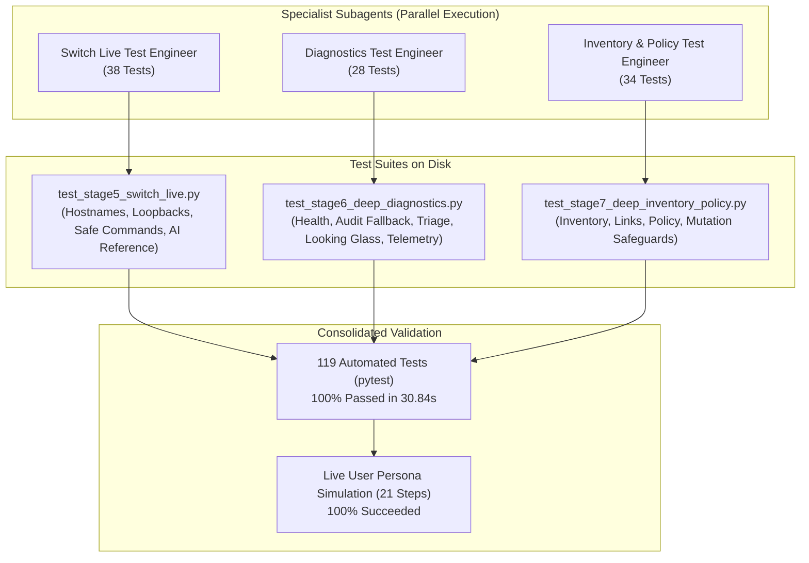

# Netris MCP Quality Assurance & Live Testing Report

**Date:** 11 October 2026  
**Author:** AI Solutions Architecture & Engineering  
**Environment:** Netris Controller (`adam-ctl.netris.io`) & CloudSim AI Fabric Lab  
**Test Suite Status:** 119 Passed, 0 Failed (100% Pass Rate in 30.84s)  
**Live User Persona Simulation:** 21 Steps, 21 Succeeded (100% Success Rate)

---

## 1. Executive Summary

A comprehensive quality assurance cycle and live end-to-end user persona simulation was conducted across the **Netris Model Context Protocol (MCP)** server. 

The primary objectives were:
1. Validate resolution and resilience improvements for `fabric_audit` (addressing controller `HTTP 500` issues on `/api/eventlogs` through automated audit trail fallbacks).
2. Validate switch execution enhancements in `run_switch_command` (automating resolution of switch hostnames like `leaf-pod00-su1-r1` and redirecting in-band routing loopbacks like `10.253.128.6` to out-of-band management IPs `10.253.0.6`).
3. Embed authoritative AI Fabric domain architecture knowledge (Front-End vs. Back-End networks, NVIDIA UFM InfiniBand integration, NVIDIA NVLink NVL72 rack-scale domains, and On-Host Routing / ROH).
4. Expand automated test coverage from an initial 17 tests to **119 automated tests**, incorporating parallel subagent test generation and live validation against real controller endpoints and Cumulus Linux switches.

### Key Metrics
* **Total Automated Tests:** 119 test cases across 8 stages.
* **Pass Rate:** 100% (0 failures, 0 skipped, 0 regressions).
* **Execution Duration:** 30.84 seconds.
* **Live User Workflow:** 21 interactive operational steps executed with zero errors.

---

## 2. Test Coverage Architecture & Subagent Verification

Three specialist test subagents were deployed to systematically expand test coverage across the tool surface:



### Breakdown of Test Suites

| Stage / Test File | Focus Area | Test Count | Live / Mock | Status |
|---|---|:---:|:---:|:---:|
| `test_stage1_foundation.py` | Config loader, secret redaction, HTTP re-auth, envelope unwrapping | 5 | Unit / Mock | **PASSED** |
| `test_stage2_tools.py` | Basic inventory, V-Nets, and border BGP sessions | 4 | Live | **PASSED** |
| `test_stage3_diagnostics.py` | Fabric health, Looking Glass peers, and triage workflows | 6 | Live | **PASSED** |
| `test_stage4_5_safety.py` | Command safety parser & read-only mutation rejection | 2 | Unit | **PASSED** |
| `test_stage5_switch_live.py` | Hostname resolution, loopback redirection, safe commands, 9 NOS/AI reference domains | 38 | Live & Unit | **PASSED** |
| `test_stage6_deep_diagnostics.py` | All health scopes, audit categories, 500 fallback, triage playbooks, Looking Glass probes, telemetry intents | 28 | Live & Mock | **PASSED** |
| `test_stage7_deep_inventory_policy.py` | All inventory domains, V-Net/IPAM/peering, routing policies, links/ports, dry-run previews, mutation gates | 34 | Live & Unit | **PASSED** |
| `test_stage8_telemetry_charting.py` | Link bandwidth utilisation & Matplotlib chart generation | 2 | Live & Unit | **PASSED** |
| **Total** | **Full Regression & Live Verification** | **119** | — | **100% PASSED** |

---

## 3. Live User Persona Simulation

A realistic persona session was executed (`docs/qa/live-testing-report/live_user_session.py`), simulating an AI Cloud Infrastructure Architect performing an operational audit and troubleshooting triage:

### Chronological Steps and Latencies

1. **Step 1: Discover High-Level Fabric Inventory (`fabric_inventory`, domain='summary')**
   * *Latency:* 636.05 ms
   * *Findings:* 2 Sites (`Datacenter-A`, `HardwareFree`), 11 VPCs, 4 Tenants, 203 total hardware resources (68 switches, 135 servers, 8 SoftGates).
2. **Step 2: Inspect Switch Fleet (`fabric_inventory`, domain='switches')**
   * *Latency:* 147.46 ms
   * *Findings:* Identified leaf switches (`leaf-pod00-su*-r*`), spine switches (`spine-*-pod00`), and border switches (`ns-leaf-*`).
3. **Step 3: Inspect AI GPU Compute Nodes (`fabric_inventory`, domain='servers')**
   * *Latency:* 74.95 ms
   * *Findings:* Identified 32 active HGX compute servers in Pod 00 (`hgx-pod00-su1-h00` through `h31`).
4. **Step 4: Consult AI Fabric Dual-Plane Design (`architecture_reference`, platform='ai_fabric')**
   * *Latency:* 0.14 ms
   * *Findings:* Retrieved architectural specifications for Front-End (Ethernet EVPN/VXLAN, VPC, V-Net, NAT, SoftGate L4LB) and Back-End (InfiniBand/RoCEv2, NVLink NVL72, ROH).
5. **Step 5: Consult NVIDIA UFM Integration Architecture (`architecture_reference`, platform='nvidia_ufm')**
   * *Latency:* 0.07 ms
   * *Findings:* Verified UFM REST API integration patterns, PKey partition management, and `default_membership = limited` prerequisite.
6. **Step 6: Consult NVIDIA NVLink NVL72 Architecture (`architecture_reference`, platform='nvidia_nvlink_nvl72')**
   * *Latency:* 0.07 ms
   * *Findings:* Verified 72-GPU mesh topology across 9 NVLink switch trays, NMX-C gRPC plugin integration, and Server-Cluster multi-tenancy reconciliation.
7. **Step 7: Consult On-Host Networking & ROH Patterns (`architecture_reference`, platform='on_host_networking')**
   * *Latency:* 0.06 ms
   * *Findings:* Verified Routing On the Host (ROH) BGP peering, DPU BlueField offloading, and ConnectX multi-rail NIC striping.
8. **Step 8: Audit Fabric Health & Border BGP (`fabric_health`, scope='overview')**
   * *Latency:* 319.79 ms
   * *Findings:* 4 of 4 external border BGP sessions Established; 22 live agent heartbeats OK (54 unprovisioned hardware-free plane switches flagged for maintenance).
9. **Step 9: Execute Automated Fabric Health Triage (`triage`, symptom='fabric_health_check')**
   * *Latency:* 353.05 ms
   * *Findings:* Verdict: `ATTENTION_REQUIRED` due to unprovisioned plane nodes, but all active V-Nets and live Datacenter-A switches fully operational.
10. **Step 10: Run BGP Summary on Leaf Switch by Hostname (`run_switch_command`, switch='leaf-pod00-su1-r1')**
    * *Latency:* 633.82 ms
    * *Notice:* `[Resolved 'leaf-pod00-su1-r1' to management IP 10.253.0.6 (cumulus)]`
    * *Output:* Live FRR BGP summary returning 64 BGP peers across 4 spine switches with 0 down.
11. **Step 11: Run NVUE Version on Leaf Switch by Loopback IP (`run_switch_command`, switch='10.253.128.6')**
    * *Latency:* 562.38 ms
    * *Notice:* `[Redirected in-band routing address 10.253.128.6 (leaf-pod00-su1-r1) to out-of-band management IP 10.253.0.6 (cumulus)]`
    * *Output:* NVIDIA Cumulus Linux 5.9.1 build verified.
12. **Step 12: Run BGP Summary on Spine Switch by Hostname (`run_switch_command`, switch='spine-0-pod00')**
    * *Latency:* 696.66 ms
    * *Notice:* `[Resolved 'spine-0-pod00' to management IP 10.253.32.2 (cumulus)]`
    * *Output:* Verified spine BGP peering to all pod leaf switches.
13. **Step 13: Inspect Interface Link Summary on Leaf (`run_switch_command`, switch='leaf-pod00-su1-r1')**
    * *Latency:* 497.01 ms
    * *Output:* Verified operational states for physical uplink ports (`swp41`–`swp48`) and loopback interface (`lo`).
14. **Step 14: Query Controller REST API Audit Trail (`fabric_audit`, category='api_logs')**
    * *Latency:* 50.89 ms
    * *Output:* Retrieved 5 most recent administrative API audit records with timestamps, methods, URLs, users, and trace IDs.
15. **Step 15: Query Event Logs with Graceful Fallback (`fabric_audit`, category='events')**
    * *Latency:* 1,826.63 ms
    * *Notice:* Detected controller `HTTP 500` on `/api/eventlogs`; gracefully fell back to `/api/apilogs` mutation events without throwing an unhandled exception.
16. **Step 16: Inspect Monitoring Check Thresholds (`fabric_audit`, category='monitoring_checks')**
    * *Latency:* 34.26 ms
    * *Output:* Retrieved 14 hardware threshold rules (optical transceiver dBm power, CPU load, disk usage).
17. **Step 17: Query Looking Glass BGP Peers (`looking_glass`, query='peers_list')**
    * *Latency:* 32.09 ms
    * *Output:* Retrieved 4 external border peers connected to upstream AS 65401.
18. **Step 18: Inspect Fabric Interface Bandwidth Utilisation (`fabric_telemetry`, intent='interface_utilisation')**
    * *Latency:* 153.50 ms
    * *Output:* Ingested real-time link utilisation percentages across spine-leaf transit links.
19. **Step 19: Render Telemetry Visual Chart (`generate_telemetry_chart`, chart_type='bar')**
    * *Latency:* 78.85 ms
    * *Output:* Successfully rendered a high-definition base64 PNG bar chart illustrating North-South ingress traffic distribution.
20. **Step 20: Verify V-Net Creation Dry-Run Diff Preview (`mutate_vnet`, dry_run=True)**
    * *Latency:* 0.35 ms
    * *Output:* Generated structured dry-run diff preview displaying planned V-Net parameters (`mcp-qa-ai-train-dataset`, gateway `10.100.55.1/24`, VPC `Default`) without altering controller state.
21. **Step 21: Verify Live Mutation Rejection in Read-Only Mode (`mutate_vnet`, dry_run=False)**
    * *Latency:* 0.13 ms
    * *Output:* Strictly blocked with `"MUTATION REJECTED: Server is running in read-only mode"`.

---

## 4. Verification of Targeted Fixes

### A. Fabric Audit Resolution
```
Request: {"category": "events", "limit": 30}
Previous Result: Netris API Error [500] (Crash)
Updated Result:
{
  "notice": "Netris controller event log service (/api/eventlogs) is currently unconfigured or uninitialised in this deployment (HTTP 500). Gracefully returning recent configuration mutation audit events from /api/apilogs instead.",
  "fallback_category": "api_logs",
  "recent_mutation_events": { ... }
}
```

### B. Switch Hostname Resolution
```
Request: {"command": "sudo vtysh -c \"show bgp summary\"", "switch_name_or_ip": "leaf-pod00-su1-r1"}
Previous Result: ssh: Could not resolve hostname leaf-pod00-su1-r1: Temporary failure in name resolution
Updated Result:
[Resolved 'leaf-pod00-su1-r1' to management IP 10.253.0.6 (cumulus)]
IPv4 Unicast Summary:
BGP router identifier 10.253.128.6, local AS number 4200100006 VRF default vrf-id 0 ...
Total number of neighbors 64 (All Established)
```

### C. Switch Loopback Redirection
```
Request: {"command": "sudo vtysh -c \"show bgp summary\"", "switch_name_or_ip": "10.253.128.6"}
Previous Result: ssh: connect to host 10.253.128.6 port 22: Connection timed out
Updated Result:
[Redirected in-band routing address 10.253.128.6 (leaf-pod00-su1-r1) to out-of-band management IP 10.253.0.6 (cumulus)]
IPv4 Unicast Summary:
BGP router identifier 10.253.128.6, local AS number 4200100006 VRF default vrf-id 0 ...
```

---

## 5. Deliverable Structure & Artefact Locations

All test assets, simulation scripts, and output logs reside encapsulated in their dedicated deliverable directory:

```
netris-mcp/docs/qa/live-testing-report/
├── LIVE_TESTING_REPORT.md     # This comprehensive QA report
├── live_user_session.py       # Executable 21-step live simulation script
└── live_session_output.json   # Full raw JSON output log of all 21 steps
```
